# Motion worth making

Fifteen studies with different subjects, formats and motion languages. Every film
is 12 seconds at 30 fps. Fourteen are landscape (1280 × 720); Type in Motion is portrait
(720 × 1280). Native text, vector shapes and 3D geometry stay editable. No external
media, model calls or API keys are required.

[](../../docs/assets/showcase/gallery.mp4)

## Lottie and animated lettering

[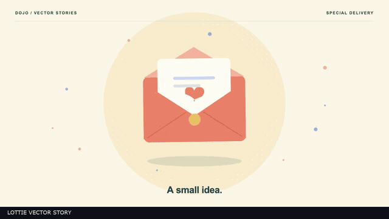](../../docs/assets/showcase/lettering.mp4)

### Special Delivery — Lottie vector story

[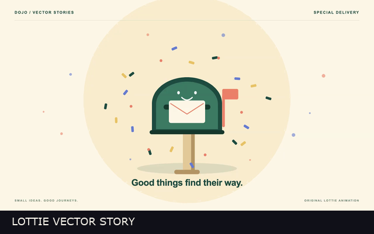](../../docs/assets/showcase/lottie.mp4)

A coral envelope unfolds, a paper airplane follows a drawn route, and a mailbox celebrates the delivery. The artwork is an original embedded Lottie document; captions remain native text.

[Watch MP4](../../docs/assets/showcase/lottie.mp4) · [Authoring source](lottie.mjs) · [Scene JSON](lottie.json)

### Make Magic — Handwritten lettering

[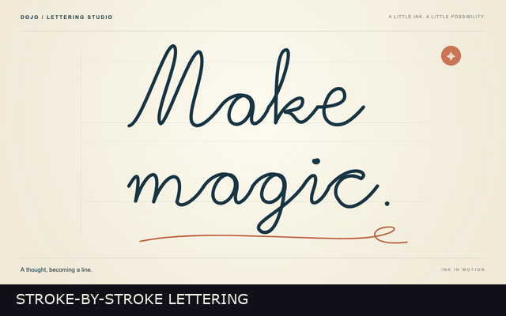](../../docs/assets/showcase/handwriting.mp4)

Original monoline letter paths write “Make magic” stroke by stroke using Lottie trim paths. This is authored vector lettering, not an arbitrary text-to-handwriting generator.

[Watch MP4](../../docs/assets/showcase/handwriting.mp4) · [Authoring source](handwriting.mjs) · [Scene JSON](handwriting.json)

### Letter / Form — Expressive typography

[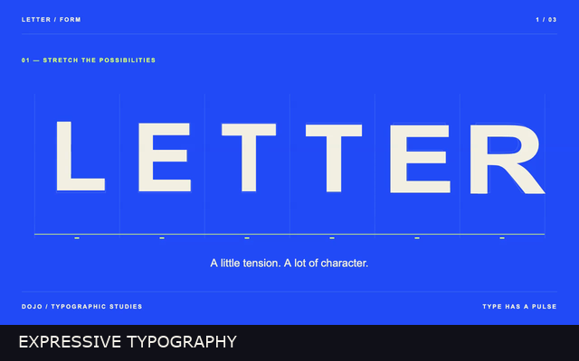](../../docs/assets/showcase/type-motion.mp4)

Native text animates through elastic letterforms, changing size and tracking, and a serif/sans finale. The words remain editable text; no variable-font axes are claimed.

[Watch MP4](../../docs/assets/showcase/type-motion.mp4) · [Authoring source](type-motion.mjs) · [Scene JSON](type-motion.json)

## Videos for different scenarios

[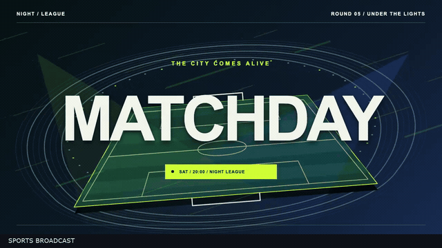](../../docs/assets/showcase/scenarios.mp4)

### Night League — Sports broadcast

[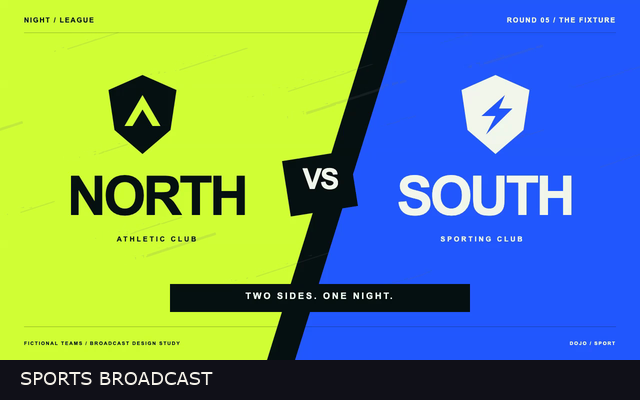](../../docs/assets/showcase/sports.mp4)

A stadium reveal, a diagonal team matchup and bold score graphics. The teams and score are fictional broadcast-design material.

[Watch MP4](../../docs/assets/showcase/sports.mp4) · [Authoring source](sports.mjs) · [Scene JSON](sports.json)

### Flow — Software product demo

[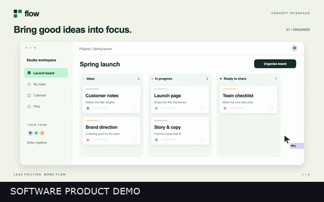](../../docs/assets/showcase/software.mp4)

Animated cards organize into a task board, a teammate reviews the work, and the project ships. This is an original concept interface drawn with editable graphics.

[Watch MP4](../../docs/assets/showcase/software.mp4) · [Authoring source](software.mjs) · [Scene JSON](software.json)

### Squeeze — Food and drink campaign

[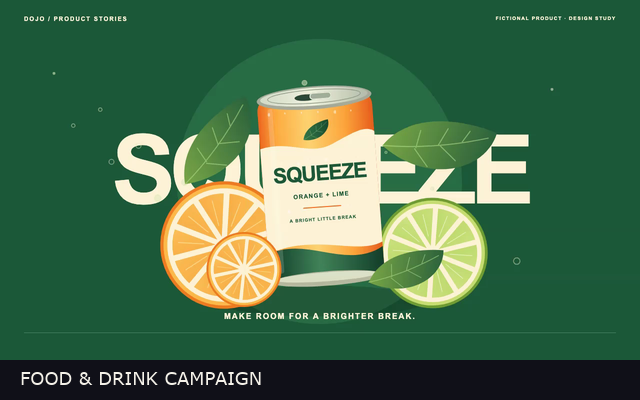](../../docs/assets/showcase/citrus.mp4)

Detailed citrus slices, a pouring ribbon, a filling glass and a branded can create a bright fictional product campaign. No nutrition or health claims are made.

[Watch MP4](../../docs/assets/showcase/citrus.mp4) · [Authoring source](citrus.mjs) · [Scene JSON](citrus.json)

## 3D and vector detail

[](../../docs/assets/showcase/showoff.mp4)

### Little Worlds — Miniature worlds

[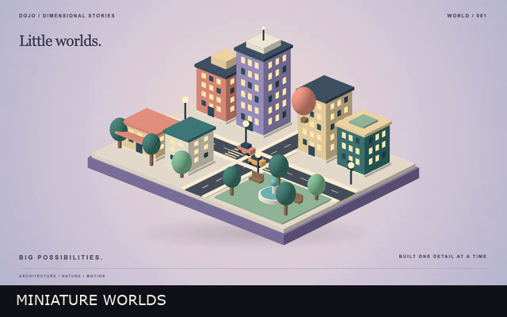](../../docs/assets/showcase/city.mp4)

A detailed floating city with staggered building assembly, warm windows, moving cars, a small park and an orbiting camera.

[Watch MP4](../../docs/assets/showcase/city.mp4) · [Authoring source](city.mjs) · [Scene JSON](city.json)

### Precision / P–01 — Exploded assembly

[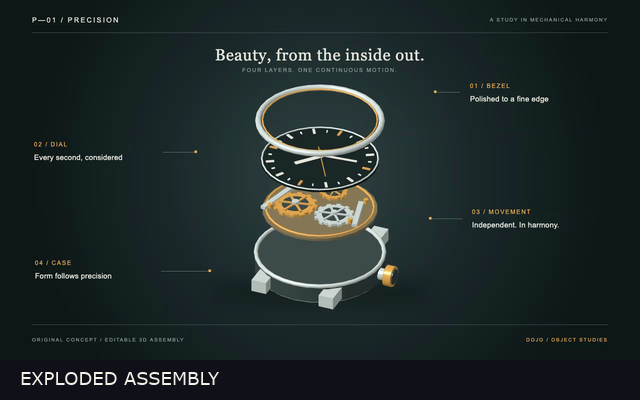](../../docs/assets/showcase/precision.mp4)

A mechanical timepiece separates into four layers, revealing independently moving gears, then reassembles. Native technical labels identify the components.

[Watch MP4](../../docs/assets/showcase/precision.mp4) · [Authoring source](precision.mjs) · [Scene JSON](precision.json)

### Chroma Bloom — Kinetic vector art

[](../../docs/assets/showcase/bloom.mp4)

Sixty gradient-filled bezier petals unfold in overlapping waves, with counter-rotating shapes and fine contour details.

[Watch MP4](../../docs/assets/showcase/bloom.mp4) · [Authoring source](bloom.mjs) · [Scene JSON](bloom.json)

## Night Train — Illustrated story

[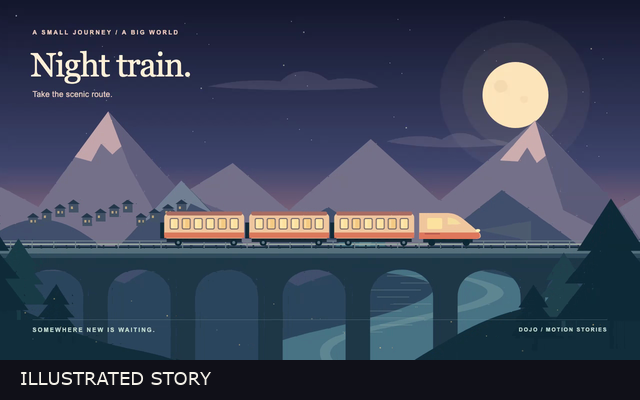](../../docs/assets/showcase/journey.mp4)

Moonlit mountains, a moving train, an arched viaduct and seven layers of parallax. Adapt it for travel, storytelling or an illustrated announcement.

[Watch MP4](../../docs/assets/showcase/journey.mp4) · [Authoring source](journey.mjs) · [Scene JSON](journey.json)

## Field Notes — Data and reports

[](../../docs/assets/showcase/data-story.mp4)

An editorial annual report with growing charts, animated counters and a flowing ideas-to-launches diagram. All figures are explicitly illustrative.

[Watch MP4](../../docs/assets/showcase/data-story.mp4) · [Authoring source](data-story.mjs) · [Scene JSON](data-story.json)

## Type in Motion — Portrait motion poster

[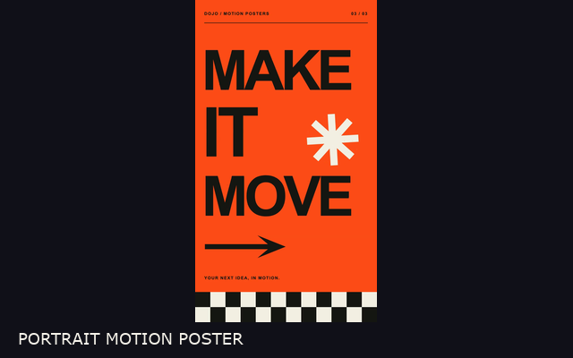](../../docs/assets/showcase/kinetic.mp4)

Giant letterforms, diagonal moving bands, checkerboards and sharp graphic cuts in a 720 × 1280 portrait composition. Adapt it for social posts or event promotion.

[Watch MP4](../../docs/assets/showcase/kinetic.mp4) · [Authoring source](kinetic.mjs) · [Scene JSON](kinetic.json)

## Deep Field — Cinematic titles

[](../../docs/assets/showcase/cinema.mp4)

A full-frame journey through a rotating architectural light tunnel, with restrained serif titles and a widescreen composition.

[Watch MP4](../../docs/assets/showcase/cinema.mp4) · [Authoring source](cinema.mjs) · [Scene JSON](cinema.json)

## After Hours — Festive 3D

[](../../docs/assets/showcase/festival.mp4)

A tiled disco sculpture, orbiting rings, floating confetti and three typography chapters. Adapt it for a celebration or team event.

[Watch MP4](../../docs/assets/showcase/festival.mp4) · [Authoring source](festival.mjs) · [Scene JSON](festival.json)

## Orbit — Company launch

[](../../docs/assets/showcase/company.mp4)

A fictional company launch in ivory, ink and cobalt. Sculptural 3D forms accompany a story about ideas, collaboration and a shared direction.

[Watch MP4](../../docs/assets/showcase/company.mp4) · [Authoring source](company.mjs) · [Scene JSON](company.json)

## Render and customize

From the engine repository root, after installing its locked dependencies:

```sh
corepack pnpm build
corepack pnpm --filter @dojo-video-engine/golden exec playwright install chromium
node examples/creative-showcase/render.mjs
```

The renderer uses the existing tool dependencies, Chromium, FFmpeg and ffprobe.
It writes Scene JSON beside the authors, render reports under
`docs/reports/showcase/`, MP4/GIF/PNG files
under `docs/assets/showcase/`, and review frames under ignored
`test-results/creative-showcase/`. It checks Scene/Three.js limits, exports via
the browser engine, counts every decoded video frame and fully decodes each MP4.
The GIFs are smaller 640 × 360, 12 fps previews of those actual exports.
Portrait previews are letterboxed; their MP4s retain the original portrait format.

After rendering all scenes, build the category cards and 12-second README reel:

```sh
node examples/creative-showcase/gallery.mjs            # approved six-category reel
node examples/creative-showcase/gallery.mjs --studies  # 3D and vector detail
node examples/creative-showcase/gallery.mjs --scenarios # sports, software and product ads
node examples/creative-showcase/gallery.mjs --lettering # Lottie and animated writing
```

This optional gallery assembly uses FFmpeg with `drawtext` support. It takes
two-second excerpts for the approved reel and four-second excerpts for the newer
studies, from the actual exports; the individual films are rendered
by the engine.

For a quick visual iteration or one film:

```sh
node examples/creative-showcase/render.mjs festival --stills
node examples/creative-showcase/render.mjs company
```

Change copy, colors, timing and the 3D object hierarchy directly in the `.mjs`
author, then render again. Animation uses explicit frame/second keyframes. The
files are serializable scenes; no executable code is embedded in the Scene JSON.

To edit on a timeline, use the matching
[Dojo Video Agent examples](https://github.com/PansaLegrand/dojo-video-agent/tree/main/examples/creative-showcase).
They import these scenes as editable projects through the normal command API.

## Evidence and scope

These are code-authored creative examples, not a benchmark of a chat agent
generating the designs. All films are silent. ORBIT is a fictional brand and Field Notes uses illustrative
data; all
graphics are original procedural geometry under this repository's MIT license.
No stock footage, external models, textures or third-party artwork is used.
System sans-serif fonts can render differently across platforms.

The committed render reports record the Scene hash, engine/browser version,
sampled preview frames and independently decoded output dimensions/count. They
qualify these fifteen examples. Three.js needs WebGL2; MP4 export needs compatible
WebCodecs. Rendering resources use the existing engine 1.2.3 limits and geometry.

The root README groups the collection into four short GitHub-hosted MP4 reels.
[Video receipts](../../docs/reports/showcase/readme-videos.json) bind their stable
attachment URLs to local file hashes. Individual films and their editable source
remain available above.

The two Lottie scenes embed original vector JSON (no expressions, external images
or fonts). The existing optional `lottie-web` dependency is already installed by
the repository tools. In Video Agent, the same JSON is bundled under content-hashed
static filenames so a later example revision does not overwrite saved projects’
asset paths. Lottie artwork and handwriting paths are edited in source; the editor
provides clip placement and playback controls. Native overlay text remains editable.
